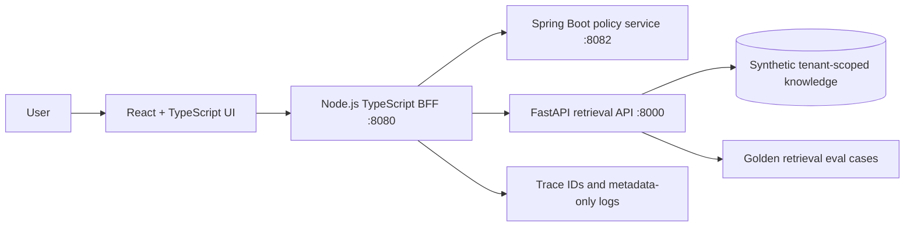

# AegisFlow AI — Enterprise Operations Copilot

**A public, synthetic-data engineering portfolio for Lead/Staff Software Engineering, Engineering Management, AI Application Engineering, and Forward Deployed Engineering.**

AegisFlow demonstrates an end-to-end enterprise workflow: a React user asks an operational question, a Node.js/TypeScript BFF resolves a *demo identity*, an independent Java/Spring Boot service makes a role-based policy decision, and a Python/FastAPI service retrieves authorized synthetic knowledge, produces an extractive grounded answer with citations (or an optional API-key-configured LLM response), and exposes a repeatable retrieval evaluation.

> **Truth-in-advertising:** This repository is a working educational baseline, **not** a production AI agent, embedding/vector database, or real financial-services application. An optional OpenAI Responses API adapter is included but cannot be exercised without your own key. Its code intentionally uses local demo headers instead of verifiable authentication tokens. **DO NOT expose it on the public Internet or ingest actual enterprise/customer data.** Planned extensions are in [Roadmap](docs/ROADMAP.md).

## Architecture



### Services

| Layer | Location | Role | Demonstrated today |
| --- | --- | --- | --- |
| React/TypeScript | `apps/web` | Responsive operations console | Tenant/role selectors, assistant queries, citations, eval UI |
| Node.js/TypeScript | `services/gateway` | BFF / API gateway | Input validation, request tracing, policy checks, timeouts, fail-closed policy dependency |
| Java 21 / Spring Boot 3.5 | `services/policy-service` | Decoupled policy engine | Policy decision API, role-based rules, tenant allowlist, unit tests |
| Python / FastAPI | `services/ai-service` | Retrieval API | Tenant-scoped BM25-like ranking, citations, extractive answers, optional Responses API adapter, prompt filter, retrieval hit@3 evaluation |
| Docker Compose | `infra` | Local orchestration | Four-service local stack bound to localhost |

## Quick start

**Requirements:** Docker with Docker Compose for the full stack. Or use Python 3.11+ and Node 22+ for the individually verified services. Java 21 and Maven 3.9+ for the Java service. Docker and Maven are not available in the authoring environment, so the full Docker and Java builds have not yet been executed here.

```bash
cd infra
docker compose up --build
```

Open `http://localhost:5173`. The service endpoints are `http://localhost:8080/api/health`, `http://localhost:8000/health`, and `http://localhost:8082/health`.

**Optional model-generated answers:** The default is fully deterministic and requires no external model account. To enable the optional OpenAI Responses API adapter, set `LLM_PROVIDER=openai`, `OPENAI_API_KEY=<your key>` and optionally `OPENAI_MODEL=<available model>` in the Python service environment, then restart it. The generator is constrained to the retrieved synthetic excerpts, requires recognized source citations, sends `store:false`, and falls back to the deterministic answer if the provider fails or returns uncited text. **The adapter has not been exercised against a live model account here.** Questions themselves will be sent to the provider when enabled: do not enter secrets or real customer data. Relevant API reference: https://developers.openai.com/api/reference/resources/responses/methods/create .

**Run Python locally:**

```bash
cd services/ai-service
python -m venv .venv
# Activate the venv for your OS
pip install -r requirements-dev.txt
uvicorn app.main:app --reload --port 8000
pytest -q
```

**Run Node gateway locally:**

```bash
cd services/gateway
# Node.js 22.16+; native TypeScript stripping is experimental in this baseline
npm test
npm run dev
```

When running only Python and Node locally, `POLICY_SERVICE_URL` is empty and the gateway uses the explicitly marked *local demo* policy. For the full cross-language flow, start the Java policy service and set `POLICY_SERVICE_URL=http://localhost:8082`.

**Run Java service locally (Maven required):**

```bash
cd services/policy-service
mvn test
mvn spring-boot:run
```

**Run React locally:**

```bash
cd apps/web
npm install
npm run dev
```

The React UI is at `http://localhost:5173` and requires the gateway. **All identities and documents are fictional.** The role dropdown is for demonstration only and is not secure authentication.

## API smoke test

```bash
curl -s http://localhost:8080/api/health

curl -s http://localhost:8080/api/ask \
  -H 'content-type: application/json' \
  -H 'x-demo-user: analyst-1' \
  -H 'x-demo-tenant: demo-bank' \
  -H 'x-demo-roles: analyst' \
  -d '{"question":"How should a failed payment be retried?"}'

curl -s http://localhost:8080/api/evals \
  -H 'x-demo-user: engineering-lead' \
  -H 'x-demo-tenant: demo-bank' \
  -H 'x-demo-roles: admin'
```

## What to show an interviewer

1. **Hands-on IC:** Walk through the TypeScript gateway, Python retriever and citation behavior, Spring policy engine, and the React front end.
2. **Architecture:** Explain why the gateway owns tenant identity, why the policy engine is independently deployable, why upstream calls have timeouts, and when the system should fail closed.
3. **Evaluation:** Run the synthetic golden dataset; explain why retrieval hit@3 does **not** measure answer groundedness or LLM quality.
4. **Leadership:** Present the [architecture decision](docs/ADR-001.md), [delivery phases](docs/ROADMAP.md), team boundaries, nonfunctional requirements, backlog and quality gates.
5. **FDE:** Present a simulated customer discovery, acceptance criteria, deployment plan and success metrics from [FDE case study](docs/FDE_CASE_STUDY.md).

## Retrieval and tool demonstration

The baseline assistant uses BM25-style ranking. To compare rankings, POST the same question and demo identity to the gateway at `/api/search` and `/api/hybrid`. Hybrid search fuses lexical ranks with cosine ranks over character trigram vectors using reciprocal rank fusion. This supports misspellings without model downloads. Trigrams measure spelling overlap. A trained semantic encoder and cross-encoder reranker remain future work.

The read-only stdio MCP service binds its tenant at startup. From `services/ai-service`, install `requirements-mcp.txt` and run `python tests/check_mcp_stdio.py` for a complete client/server exchange. To connect a local MCP client, use command `python -m app.mcp_server` in that directory with `AEGISFLOW_TENANT=demo-bank` in its environment. The client can discover and call `search_policy`.

## Verification on 14 November 2026

Nine Python API and adapter checks passed when invoked directly using FastAPI TestClient, including the hybrid spelling and tenant filter regression. Four Node gateway tests passed. The real stdio MCP client discovered the tool and retrieved a cited policy. The local Node-to-FastAPI smoke test passed two assertions, including rejection of analyst access to evaluation. The expected document appeared among the first three for four of four synthetic evaluation questions. This small set measures regression only.

Java and Docker builds, a frontend production build, live model calls, cloud infrastructure, and a production identity provider remain unverified in this environment. The demo uses local synthetic identities. See the architecture notes before extending it.

License: MIT.

### Authenticated gateway mode

For API clients, set AEGISFLOW_CREDENTIALS to a JSON array of records with digest (SHA-256 hex of a randomly generated 32-byte base64url token), user, tenant and roles (comma-separated). Send the token as an Authorization Bearer credential. Identity and roles come only from the configured records. Invalid configuration prevents startup. Remove a record and restart to revoke it. The React console defaults to the independent localhost demo-header mode. Bind backends to loopback or a private network, use TLS for remote traffic, and keep credentials outside source control. This is a pre-provisioned credential demonstration, with no interactive identity provider.

A fifth gateway test verifies credential binding and denial for missing or incorrect credentials.

### Optional integrations awaiting runtime verification

* LangGraph: install services/ai-service/requirements-workflow.txt. From that service run `PYTHONPATH=. python tests/check_workflow.py`. The retrieval node routes to either a cited extractive answer or an operator-review response. Dependency download was unavailable during verification.
* Event processing: start a private Redis and PostgreSQL instance, set REDIS_URL and DATABASE_URL, apply integrations/audit/schema.sql and install the adjacent requirements.txt. Start worker.py, run publish_sample.py with the gateway in local demo mode, and query retrieval_event for the printed UUID. The consumer commits its stream cursor and idempotent event insert in one database transaction. Run the worker again to resume from the committed cursor. This optional sample emits metadata from an explicit lookup. It does not record every request. These backend services were unavailable for a runtime check.
* AWS deployment design: serve the frontend from S3/CloudFront, place the gateway behind an HTTPS load balancer, keep the policy and retrieval services on private EKS networking, and restrict the worker to ElastiCache and RDS using scoped security groups. Keep credentials in Secrets Manager. This topology is a design, with no live AWS deployment.

For a local disposable Kubernetes cluster, build images tagged aegisflow-ai:local, aegisflow-policy:local, aegisflow-gateway:local and aegisflow-web:local from their service directories. Load them into your cluster, apply infra/kubernetes-local.yaml in a dedicated namespace, then port-forward service/web 5173:5173 and service/gateway 8080:8080. The manifest defines four deployments and four ClusterIP services. Only YAML structure was checked locally.
